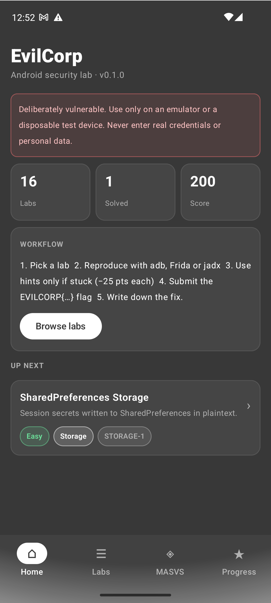
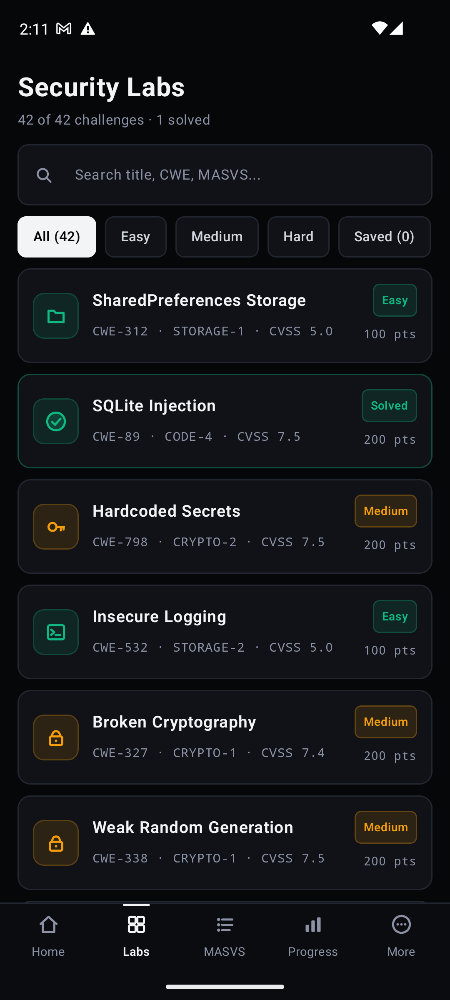
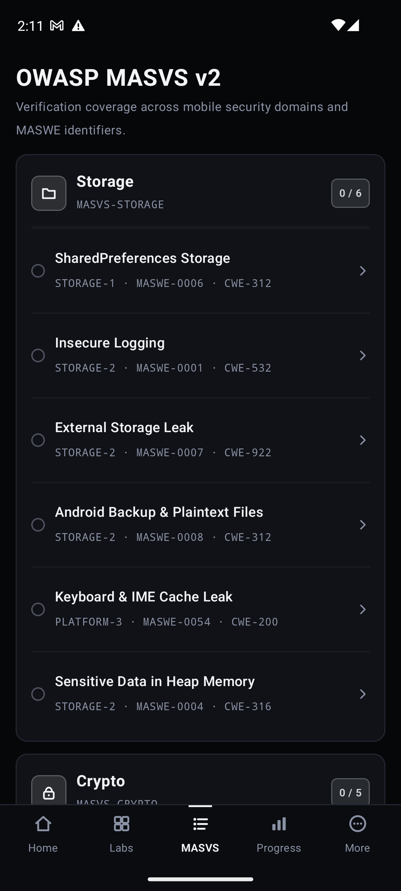
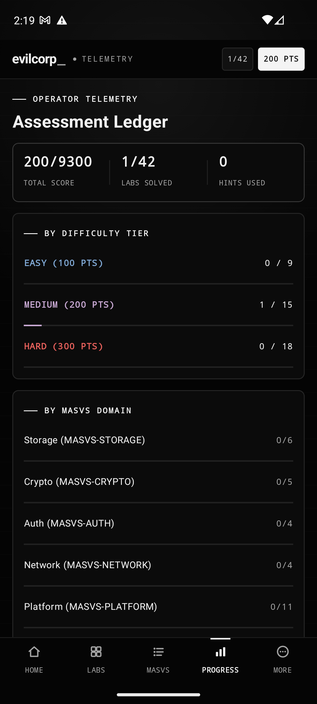
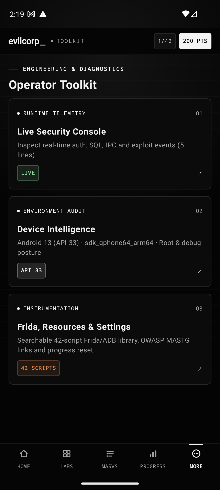

<div align="center">

# EvilCorp Android

**An intentionally vulnerable Jetpack Compose laboratory for structured Android security training**

[](https://github.com/jankesec/evilcorp-android/actions/workflows/ci.yml)
[](https://kotlinlang.org/)
[](https://developer.android.com/)
[](#challenge-catalog)
[](LICENSE)

Forty-two self-contained labs mapped to CWE, OWASP MASVS v2, MASTG and MASWE, with progressive hints,
CTF flags and scoring, local progress tracking, and adb / Frida / jadx examples per lab.
The Android companion to [evilcorp-ios](https://github.com/jankesec/evilcorp-ios).

</div>

> [!CAUTION]
> EvilCorp is deliberately insecure. Run it only on an emulator or a disposable test
> device. Do not use personal credentials, personal data, production accounts, or a device
> you rely on.

## Interface

<div align="center">
  
  
  
  
  
</div>

## What this project is

Each challenge isolates one recognizable insecure Android pattern and links the hands-on
exercise to industry taxonomy. It is designed for:

- Android application-security workshops and CTFs;
- OWASP MASVS / MASWE / MASTG study;
- static analysis practice (jadx, apktool, manifest review);
- dynamic analysis practice (adb, Frida, objection, drozer, proxies).

It is not a production security reference. Several APIs are used insecurely on purpose
because the insecure behavior is the subject of the lab.

## Quick start

Requirements: Android Studio (or JDK 17+ and the Android SDK with API 36), plus an
emulator or test device running Android 8.0 (API 26) or newer.

```bash
git clone https://github.com/jankesec/evilcorp-android.git
cd evilcorp-android
make run          # build, install on the connected emulator, launch
make check        # build + unit tests + plaintext-flag scan (what CI runs)
make sast         # Semgrep benchmark rules (rules/semgrep-evilcorp.yml)
make verify-labs  # check every adb-solvable lab on the running emulator
```

Useful extras: [jadx](https://github.com/skylot/jadx), [apktool](https://apktool.org/),
[Frida](https://frida.re/) / [objection](https://github.com/sensepost/objection).
A Google APIs (non-Play) emulator image works for every lab; Frida needs a rooted
emulator or a frida-gadget build.

## Training workflow

1. Pick a lab from **Labs** or the **MASVS** coverage view.
2. Read the scenario and reproduce the weakness with external tooling.
3. Reveal hints only when stuck (−25 points each, never below half the lab's value).
4. Submit the `EVILCORP{…}` flag.
5. Write down the observation, the affected control, and the remediation shown in the lab.

## Challenge catalog

| # | Challenge | Area | Difficulty | Mapping |
|---:|---|---|---|---|
| 1 | SharedPreferences Storage | Storage | Easy | CWE-312 · STORAGE-1 · MASWE-0001 · MASTG-TEST-0287 |
| 2 | SQLite Injection | Code | Medium | CWE-89 · CODE-4 · MASWE-0050 · MASTG-TEST-0025 |
| 3 | Hardcoded Secrets | Storage | Medium | CWE-798 · STORAGE-1 · MASWE-0004 · MASTG-TEST-0212 |
| 4 | Insecure Logging | Storage | Easy | CWE-532 · STORAGE-2 · MASWE-0005 · MASTG-TEST-0203 |
| 5 | Broken Cryptography | Crypto | Medium | CWE-327 · CRYPTO-1 · MASWE-0007 · MASTG-TEST-0232 |
| 6 | Weak Random Generation | Crypto | Medium | CWE-338 · CRYPTO-1 · MASWE-0012 · MASTG-TEST-0204 |
| 7 | WebView JavaScript Bridge | Platform | Medium | CWE-79 · PLATFORM-2 · MASWE-0033 · MASTG-TEST-0334 |
| 8 | Exported ContentProvider | Platform | Medium | CWE-926 · PLATFORM-1 · MASWE-0018 · MASTG-TEST-0356 |
| 9 | Deep Link Abuse | Platform | Medium | CWE-939 · PLATFORM-1 · MASWE-0029 · MASTG-TEST-0394 |
| 10 | Root Detection Bypass | Resilience | Medium | CWE-693 · RESILIENCE-1 · MASWE-0051 · MASTG-TEST-0325 |
| 11 | Cleartext HTTP Session | Network | Medium | CWE-319 · NETWORK-1 · MASWE-0026 · MASTG-TEST-0236 |
| 12 | External Storage Leak | Storage | Easy | CWE-922 · STORAGE-2 · MASWE-0002 · MASTG-TEST-0200 |
| 13 | Unprotected Broadcast Receiver | Platform | Hard | CWE-925 · PLATFORM-1 · MASWE-0018 · MASTG-TEST-0366 |
| 14 | Clipboard Leakage | Platform | Easy | CWE-200 · PLATFORM-1 · MASWE-0030 |
| 15 | Vulnerable Vault PIN | Auth | Hard | CWE-307 · AUTH-2 · MASWE-0020 |
| 16 | Screenshot Leakage | Platform | Easy | CWE-200 · PLATFORM-3 · MASWE-0038 · MASTG-TEST-0291 |
| 17 | PKCS#12 Keystore Misuse | Crypto | Medium | CWE-522 · CRYPTO-2 · MASWE-0003 · MASTG-TEST-0212 |
| 18 | Android Backup & Plaintext Files | Storage | Easy | CWE-312 · STORAGE-2 · MASWE-0006 · MASTG-TEST-0216 |
| 19 | SSL Pinning Bypass | Network | Hard | CWE-295 · NETWORK-2 · MASWE-0028 · MASTG-TEST-0242 |
| 20 | WebView Universal File Access | Platform | Hard | CWE-200 · PLATFORM-2 · MASWE-0034 · MASTG-TEST-0252 |
| 21 | Biometric Auth Bypass | Auth | Hard | CWE-287 · AUTH-2 · MASWE-0020 · MASTG-TEST-0327 |
| 22 | Debugger & Frida Detection | Resilience | Hard | CWE-693 · RESILIENCE-4 · MASWE-0064 · MASTG-TEST-0353 |
| 23 | Keyboard & IME Cache Leak | Storage | Easy | CWE-200 · STORAGE-2 · MASWE-0036 · MASTG-TEST-0258 |
| 24 | Bytecode Tampering & Licensing | Resilience | Hard | CWE-353 · RESILIENCE-2 · MASWE-0058 · MASTG-TEST-0341 |
| 25 | HTTP Disk Cache Leak | Storage | Medium | CWE-524 · STORAGE-2 · MASWE-0001 · MASTG-TEST-0207 |
| 26 | Mutable PendingIntent Hijack | Platform | Hard | CWE-927 · PLATFORM-1 · MASWE-0032 · MASTG-TEST-0381 |
| 27 | Tapjacking / Obscured Touch | Platform | Medium | CWE-1021 · PLATFORM-3 · MASWE-0039 · MASTG-TEST-0340 |
| 28 | Sensitive Data in Heap Memory | Storage | Hard | CWE-316 · STORAGE-2 · MASWE-0024 · MASTG-TEST-0011 |
| 29 | Intent Redirection | Platform | Hard | CWE-940 · PLATFORM-1 · MASWE-0032 · MASTG-TEST-0364 |
| 30 | Zip Slip / Path Traversal | Code | Hard | CWE-22 · CODE-4 · MASWE-0050 |
| 31 | Insecure JWT & alg:none | Auth | Medium | CWE-347 · AUTH-1 · MASWE-0018 |
| 32 | Missing Step-Up Authentication | Auth | Hard | CWE-306 · AUTH-3 · MASWE-0023 |
| 33 | TrustAll X509TrustManager | Network | Medium | CWE-295 · NETWORK-1 · MASWE-0027 · MASTG-TEST-0282 |
| 34 | Static IV & Nonce Reuse | Crypto | Hard | CWE-323 · CRYPTO-1 · MASWE-0007 · MASTG-TEST-0309 |
| 35 | Unverified Dynamic Code Loading | Code | Hard | CWE-494 · CODE-4 · MASWE-0049 |
| 36 | Unsafe Java Deserialization | Code | Hard | CWE-502 · CODE-4 · MASWE-0050 · MASTG-TEST-0337 |
| 37 | JNI Stack Buffer Overflow | Code | Hard | CWE-120 · CODE-4 · MASWE-0050 · MASTG-TEST-0043 |
| 38 | Emulator Detection Bypass | Resilience | Medium | CWE-693 · RESILIENCE-1 · MASWE-0053 · MASTG-TEST-0351 |
| 39 | APK Signature & Installer Check | Resilience | Hard | CWE-345 · RESILIENCE-2 · MASWE-0056 · MASTG-TEST-0050 |
| 40 | Persistent Device Fingerprinting | Privacy | Easy | CWE-359 · PRIVACY-2 · MASWE-0068 · MASTG-TEST-0318 |
| 41 | Public Lockscreen Notification Leak | Platform | Easy | CWE-200 · PLATFORM-3 · MASWE-0037 · MASTG-TEST-0315 |
| 42 | Task Affinity & Activity Hijack | Platform | Hard | CWE-1021 · PLATFORM-3 · MASWE-0039 |

MASWE ids use the stable OWASP numbering (MASWE-0001 to MASWE-0078) and MASTG ids point to the
current Android tests, both checked against the [OWASP maswe](https://github.com/OWASP/maswe) and
[OWASP mastg](https://github.com/OWASP/mastg) sources in November 2026. Labs with no Android MASTG
test list none. Mappings are training metadata, not a formal compliance assessment; confirm current
OWASP definitions before using them in an audit or report.

## Flags and scoring integrity

Flags are never stored as plaintext in the APK. Maintainers edit `app/flags.properties`; the build
turns it into XOR-encoded bytes plus SHA-256 digests, labs decode their flag only on their own
exploitation path, and submissions are checked against the digest. `make check` (and CI) fails if a
flag ever reaches the APK as a greppable string. A client-side CTF cannot be cheat-proof: reversing
`FlagVault` or hooking it with Frida still reveals every flag, so treat flags as learning checkpoints.

Some labs still simulate the vulnerable component inside the app instead of using a real one:
#19 SSL Pinning and #33 TrustAll TrustManager (no TLS endpoint), #26 PendingIntent, #27 Tapjacking
and #42 Task Affinity (no second app involved), #35 Dynamic Code Loading (no real `DexClassLoader`)
and #37 JNI overflow (the C library ships for static analysis; the screen models the frame in Kotlin).

## Deliberately insecure configuration

- `android:allowBackup="true"`, cleartext traffic allowed, user CAs trusted
  ([network_security_config.xml](app/src/main/res/xml/network_security_config.xml));
- exported `ContentProvider`, `BroadcastReceiver`, deep-link `Activity`, and `IntentRedirectActivity`
  without permissions, plus a non-exported `InternalAdminActivity` reachable via intent redirection;
- mutable implicit `PendingIntent` broadcasts (opting out of the Android 14 block with
  `FLAG_ALLOW_UNSAFE_IMPLICIT_INTENT`);
- a wire-approval notification posted with `VISIBILITY_PUBLIC` and a token in its extras;
- WebViews with JavaScript, a `@JavascriptInterface` bridge, remote debugging, and `file://` access;
- no R8/ProGuard obfuscation on any build type;
- hard-coded synthetic keys, portable PKCS#12 store with default password, static AES-ECB key,
  unsalted MD5 PIN verifier, and immutable `String` secrets retained on the heap;
- client-side authentication, licensing, SSL pinning, anti-debugging, and root-detection decisions.

All network activity stays on the device loopback (`127.0.0.1:8080`, reachable via
`adb forward`). The app makes no external network calls and collects nothing.

## Repository layout

```text
.
├── app/flags.properties   Flag source of truth (compiled into FlagVaultData, never shipped as text)
├── app/src/main/
│   ├── cpp/          C source for libevilcorp_native.so (Ghidra / IDA / Native Frida target)
│   ├── jniLibs/      Prebuilt ARM64 & x86_64 ELF shared libraries (libevilcorp_native.so)
│   └── java/com/evilcorp/android/
│       ├── model/    Challenge catalog (single source of truth) and scoring
│       ├── labs/     42 self-contained security labs, FlagVault + registry
│       ├── data/     Local progress store and runtime security log
│       └── ui/       Compose screens (Home, Labs, MASVS, Progress, More, Detail)
├── app/src/test/     Catalog, taxonomy, scoring, flag-vault and lab invariants
├── docs/             Instructor walkthrough & SAST/DAST benchmark matrix
├── frida/            Universal Frida instrumentation & bypass suite
├── rules/            Semgrep SAST benchmark rules (semgrep-evilcorp.yml)
├── scripts/          ADB lab verification runner (PASS / TODO / FAIL per lab)
├── Makefile          build / test / flags / check / sast / verify-labs / run / release
└── .github/workflows/ci.yml & release.yml
```

## Author

```text
Author          : Sevban Dönmez (@jankesec)
Role            : Senior Cyber Security Consultant · Red Team & Offensive Security Researcher
Research Portal : https://jankesec.com
GitHub          : https://github.com/jankesec
PGP Fingerprint : FF0A 7D83 6751 CCE3 F9CC F574 FCF8 39FB 7F00 4626
GPG Key ID      : 5FDB257F4AAE8C3F
```

## Responsible use

Use EvilCorp only on systems you own or are explicitly authorized to test. Read
[CONTRIBUTING.md](CONTRIBUTING.md) before changing lab behavior; repository-level issues
outside the intentionally vulnerable scope follow [SECURITY.md](SECURITY.md).

## License

MIT. See [LICENSE](LICENSE).

<p align="center">
  <a href="https://buymeacoffee.com/sevbandonmez">
    
  </a>
</p>
