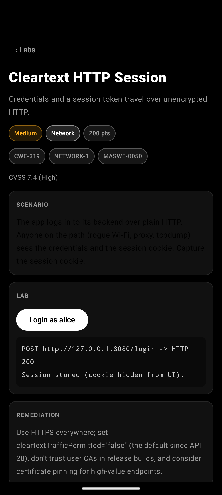
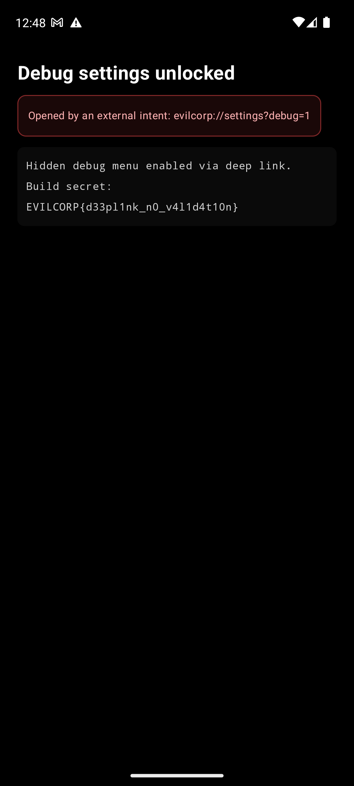

<div align="center">

# EvilCorp Android

**An intentionally vulnerable Jetpack Compose laboratory for structured Android security training**

[](https://github.com/jankesec/evilcorp-android/actions/workflows/ci.yml)
[](https://kotlinlang.org/)
[](https://developer.android.com/)
[](#challenge-catalog)
[](LICENSE)

Sixteen self-contained labs mapped to CWE, OWASP MASVS and MASWE, with progressive hints,
CTF flags and scoring, local progress tracking, and adb / Frida / jadx examples per lab.
The Android companion to [evilcorp-ios](https://github.com/jankesec/evilcorp-ios).

</div>

> [!CAUTION]
> EvilCorp is deliberately insecure. Run it only on an emulator or a disposable test
> device. Do not use personal credentials, personal data, production accounts, or a device
> you rely on.

## Interface

<div align="center">
  
  
  
  
</div>

## What this project is

Each challenge isolates one recognizable insecure Android pattern and links the hands-on
exercise to industry taxonomy. It is designed for:

- Android application-security workshops and CTFs;
- OWASP MASVS / MASWE / MASTG study;
- static analysis practice (jadx, apktool, manifest review);
- dynamic analysis practice (adb, Frida, objection, drozer, proxies).

It is not a production security reference. Several APIs are used insecurely on purpose
because the insecure behavior is the subject of the lab.

## Quick start

Requirements: Android Studio (or JDK 17+ and the Android SDK with API 36), plus an
emulator or test device running Android 8.0 (API 26) or newer.

```bash
git clone https://github.com/jankesec/evilcorp-android.git
cd evilcorp-android
make run        # build, install on the connected emulator, launch
make check      # build + unit tests (what CI runs)
```

Useful extras: [jadx](https://github.com/skylot/jadx), [apktool](https://apktool.org/),
[Frida](https://frida.re/) / [objection](https://github.com/sensepost/objection).
A Google APIs (non-Play) emulator image works for every lab; Frida needs a rooted
emulator or a frida-gadget build.

## Training workflow

1. Pick a lab from **Labs** or the **MASVS** coverage view.
2. Read the scenario and reproduce the weakness with external tooling.
3. Reveal hints only when stuck (−25 points each, never below half the lab's value).
4. Submit the `EVILCORP{…}` flag.
5. Write down the observation, the affected control, and the remediation shown in the lab.

## Challenge catalog

| # | Challenge | Area | Difficulty | Mapping |
|---:|---|---|---|---|
| 1 | SharedPreferences Storage | Storage | Easy | CWE-312 · STORAGE-1 · MASWE-0006 |
| 2 | SQLite Injection | Storage | Medium | CWE-89 · CODE-4 · MASWE-0079 |
| 3 | Hardcoded Secrets | Storage | Medium | CWE-798 · CRYPTO-2 · MASWE-0005 |
| 4 | Insecure Logging | Storage | Easy | CWE-532 · STORAGE-2 · MASWE-0001 |
| 5 | Broken Cryptography | Crypto | Medium | CWE-327 · CRYPTO-1 · MASWE-0020 |
| 6 | Weak Random Generation | Crypto | Medium | CWE-338 · CRYPTO-1 · MASWE-0027 |
| 7 | WebView JavaScript Bridge | Platform | Medium | CWE-79 · PLATFORM-2 · MASWE-0068 |
| 8 | Exported ContentProvider | Platform | Medium | CWE-926 · PLATFORM-1 · MASWE-0063 |
| 9 | Deep Link Abuse | Platform | Medium | CWE-939 · PLATFORM-1 · MASWE-0058 |
| 10 | Root Detection Bypass | Resilience | Medium | CWE-693 · RESILIENCE-1 · MASWE-0097 |
| 11 | Cleartext HTTP Session | Network | Medium | CWE-319 · NETWORK-1 · MASWE-0050 |
| 12 | External Storage Leak | Storage | Easy | CWE-922 · STORAGE-2 · MASWE-0007 |
| 13 | Unprotected Broadcast Receiver | Platform | Hard | CWE-927 · PLATFORM-1 · MASWE-0064 |
| 14 | Clipboard Leakage | Platform | Easy | CWE-200 · STORAGE-2 · MASWE-0053 |
| 15 | Vulnerable Vault PIN | Auth | Hard | CWE-307 · AUTH-2 · MASWE-0036 |
| 16 | Screenshot Leakage | Platform | Easy | CWE-200 · PLATFORM-3 · MASWE-0055 |

Mappings are training metadata, not a formal compliance assessment. Confirm current OWASP
definitions before using them in an audit or report.

## Deliberately insecure configuration

- `android:allowBackup="true"`, cleartext traffic allowed, user CAs trusted
  ([network_security_config.xml](app/src/main/res/xml/network_security_config.xml));
- an exported `ContentProvider`, `BroadcastReceiver` and deep-link `Activity` without permissions;
- a WebView with JavaScript and a `@JavascriptInterface` bridge plus remote debugging;
- no R8/ProGuard obfuscation on any build type;
- hard-coded synthetic keys, static AES-ECB key, unsalted MD5 PIN verifier;
- client-side authentication and root-detection decisions.

All network activity stays on the device loopback (`127.0.0.1:8080`, reachable via
`adb forward`). The app makes no external network calls and collects nothing.

## Repository layout

```text
.
├── app/src/main/java/com/evilcorp/android/
│   ├── model/        Challenge catalog (single source of truth) and scoring
│   ├── labs/         One file per lab + flags + registry
│   ├── data/         Local progress store
│   └── ui/           Compose screens (Home, Labs, MASVS, Progress, detail)
├── app/src/test/     Catalog, scoring and flag invariants
├── Makefile          build / test / install / run / release
└── .github/workflows/ci.yml
```

## Responsible use

Use EvilCorp only on systems you own or are explicitly authorized to test. Read
[CONTRIBUTING.md](CONTRIBUTING.md) before changing lab behavior; repository-level issues
outside the intentionally vulnerable scope follow [SECURITY.md](SECURITY.md).

## License

MIT. See [LICENSE](LICENSE).
